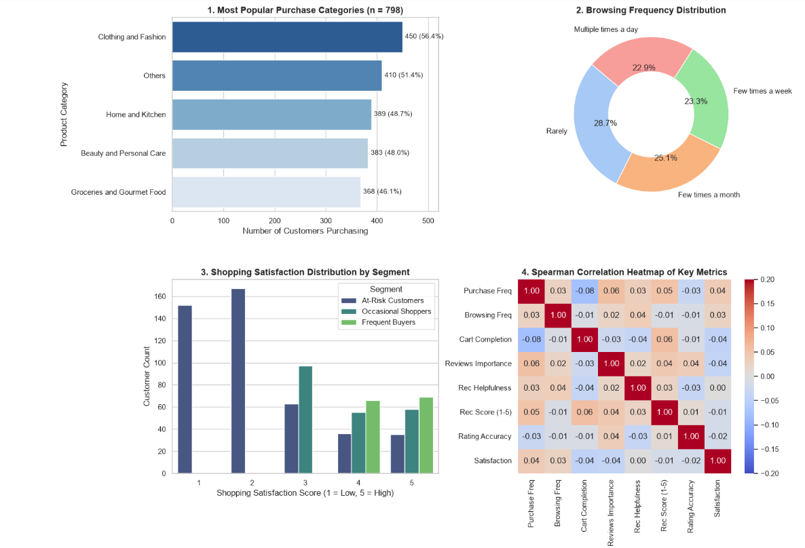
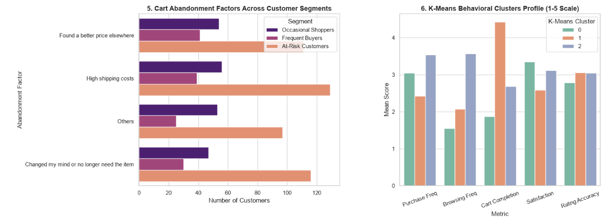

# Machine Learning Project: Amazon Customer Purchasing Behavior & Market Basket Analysis

## Project Overview
This project analyzes online shopping behavior, product category affinities, and engagement trends across **798 verified survey responses**. The primary objective is to clean transaction data, uncover cross-selling opportunities via **Market Basket Analysis (Association Rule Mining)**, segment customers using **Rule-Based criteria and K-Means Clustering**, and provide data-backed recommendations for inventory optimization and cart abandonment reduction.

> *Note: This project's dataset was created for pedagogical purposes and does not represent actual production commerce data.*

---

## Key Statistical Findings & Metrics

| Category | Statistical Findings & Metrics | Strategic Implication |
| :--- | :--- | :--- |
| **Demographics & Sample** | • Sample Size: $n = 798$ unique records • Age: $\text{Mean} = 35.18$, $\text{Median} = 35.50$ • Gender: Evenly split ($\approx 24\text{--}26\%$ each) | Ensures a broad, unbiased cross-section of customer feedback without demographic skew. |
| **Top Product Categories** | • **Clothing & Fashion**: 56.39% ($n=450$) • **Home & Kitchen**: 48.75% ($n=389$) • **Beauty & Personal Care**: 47.99% ($n=383$) | Focus primary cross-sell promotions on apparel, home goods, and personal care bundles. |
| **Cross-Selling Affinities** | • *Groceries $\rightarrow$ Home & Kitchen*:   - Support = **22.56%**, Confidence = **48.91%**, Lift = **1.0034** • *Beauty $\rightarrow$ Clothing*:   - Confidence = **52.74%** | Implement automated "Frequently Bought Together" widget bundles during checkout. |
| **Cart Abandonment Risks** | • **High shipping costs**: 28.07% • **Better price elsewhere**: 25.81% • Total At-Risk Base: **56.77%** ($n=453$) | Introduce dynamic free-shipping progress bars and price-match guarantees. |
| **Recommendation Fatigue** | • Spearman Correlation ($r$) with Satisfaction $\approx 0.00$ • 37.91% find recommendations *Sometimes* helpful • 30.69% find them *Not* helpful | Shift collaborative filtering toward verified repeat-purchase history rather than transient clicks. |

---

## Tech Stack & Libraries
- **Language:** Python 
- **Data Manipulation & Stats:** Pandas, NumPy, SciPy (Spearman Rank Correlation)
- **Machine Learning:** Scikit-Learn (K-Means Clustering, StandardScaler)
- **Data Visualization:** Matplotlib, Seaborn

---

## Visual Dashboards & Behavioral Analysis

